<h2>KUBERNETES PORTFOLIO</h2>
<h3>Provisioned a multi-node Kubernetes cluster locally using kind (Kubernetes in Docker)</h3>
<h4>YAML File to create KIND cluster:</h4>

```
kind: Cluster
apiVersion: kind.x-k8s.io/v1alpha4

nodes:
  - role: control-plane
    image: kindest/node:v1.37.0
  - role: worker
    image: kindest/node:v1.37.0
  - role: worker
    image: kindest/node:v1.37.0
  - role: worker
    image: kindest/node:v1.37.0
    extraPortMappings:
      - containerPort: 80
        hostPort: 80
        protocol: TCP
      - containerPort: 443
        hostPort: 443
        protocol: TCP
```  


<h4> YAML File to create NameSpace using YAML </h4>

```
kind: Namespace
apiVersion: v1
metadata:
  name: demo-nginx-namespace
```


<h4>YAML File to Create POD</h4>

```
kind: Pod
apiVersion: v1
metadata:
  name: demo-nginx-pod
  namespace: demo-nginx-namespace
spec:
  containers:
  - name: nginx-container
    image: nginx:latest
    ports:
    - containerPort: 80

```
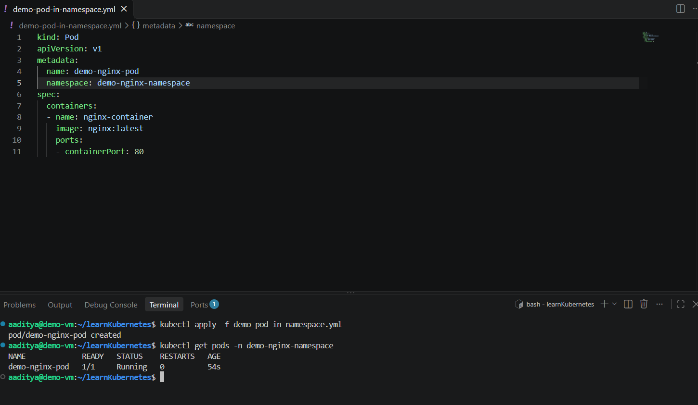

<h4> YAML File to create Deployment</h4>

```
kind: Deployment
apiVersion: apps/v1
metadata:
  name: demo-nginx-deployment
  namespace: demo-nginx-namespace
spec:
  replicas: 4
  selector:
    matchLabels:
      app: nginx-pod
  template:
    metadata:
      labels:
        app: nginx-pod
    spec:
      containers:
      - name: nginx-container
        image: nginx:latest
        ports:
        - containerPort: 80

```
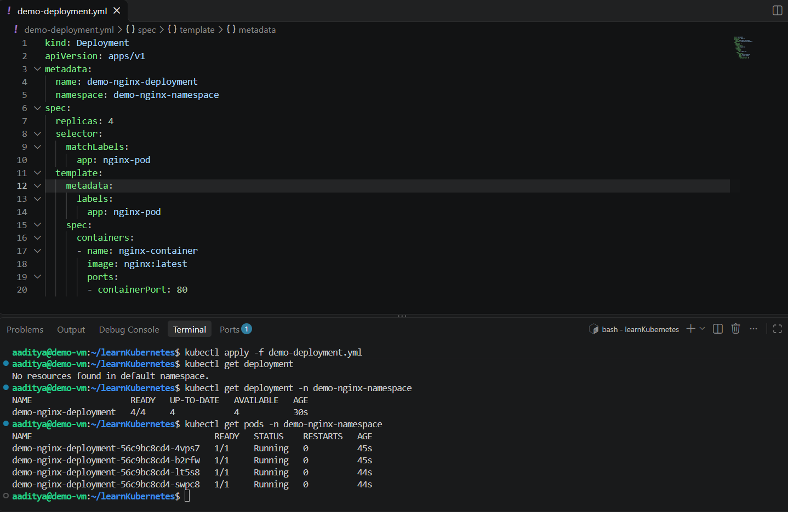

<h4> Scale Deployment</h4>

```
kubectl scale deployment/demo-nginx-deployment -n demo-nginx-namespace --replicas=8
```
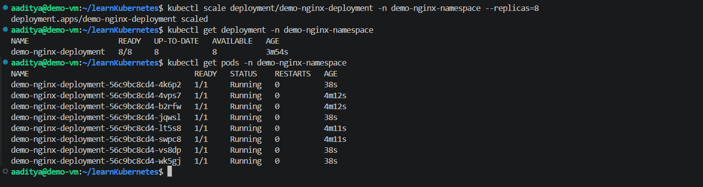

<h4>PODS Running on different nodes in KIND cluster</h4>

```
kubectl get pods -n demo-nginx-namespace -o wide
```
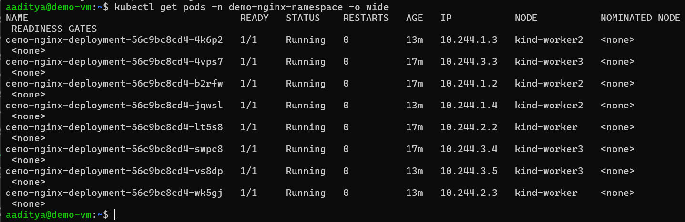

<h4>Rolling Update</h4>

```
kubectl set image deployment/demo-nginx-deployment -n demo-nginx-namespace nginx-container=nginx:1.30
```
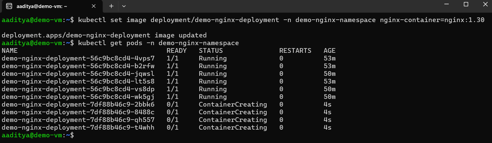

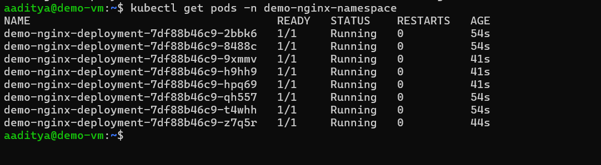

<h4>YAML to create DaemonSet</h4>

```
kind: DaemonSet
apiVersion: apps/v1
metadata:
  name: demo-nginx-daemonset
  namespace: demo-nginx-namespace
spec:
  selector:
    matchLabels:
      app: nginx-pod
  template:
    metadata:
      labels:
        app: nginx-pod
    spec:
      containers:
      - name: nginx-container
        image: nginx:latest
        ports:
        - containerPort: 80
```
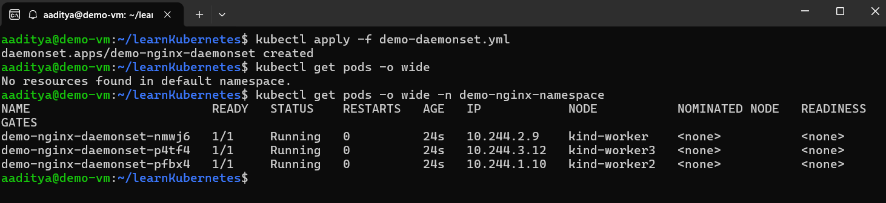

<h4>YAML to create JOBS</h4>

```
kind: Job
apiVersion: batch/v1
metadata:
  name: demo-job
  namespace: demo-nginx-namespace
spec:
  completions: 1
  parallelism: 1
  template:
    metadata:
      name: demo-job-pod
      labels:
        app: batch-job
    spec:
      containers:
      - name: batch-container
        image: busybox:latest
        command: ["sh", "-c", "echo Hello friends!! && sleep 10"]
      restartPolicy: Never
```
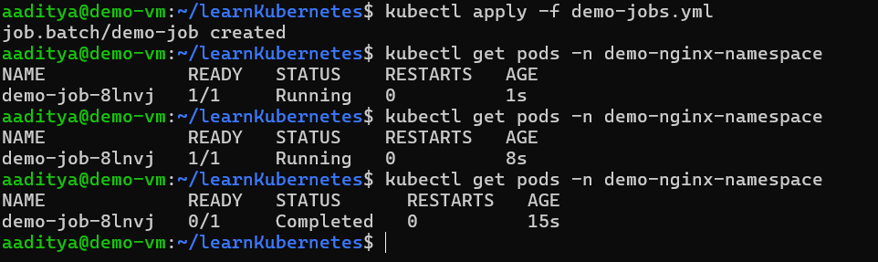
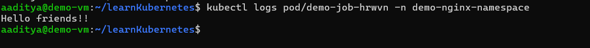

<h4>YAML to create CRON JOBS</h4>

```
kind: CronJob
apiVersion: batch/v1
metadata:
  name: demo-cron-job
  namespace: demo-nginx-namespace
spec:
  schedule: "* * * * *"
  jobTemplate:
    spec:
      template:
        metadata:
          labels:
            app: minute-backup
        spec:
          containers: 
          - name: backup-container
            image: busybox
            command:
            - sh
            - -c
            - >
              echo "Backup Started" &&
              mkdir -p /backups &&
              mkdir -p /demo-data &&
              cp -r /demo-data /backups &&
              echo "Backup Completed"
            volumeMounts: 
            - name: data-volume
              mountPath: /demo-data
            - name: backup-volume
              mountPath: /backups
          restartPolicy: OnFailure
          volumes: 
          - name: data-volume
            hostPath:
              path: /demo-data
              type: DirectoryOrCreate
          - name: backup-volume
            hostPath:
              path: /backups
              type: DirectoryOrCreate

```
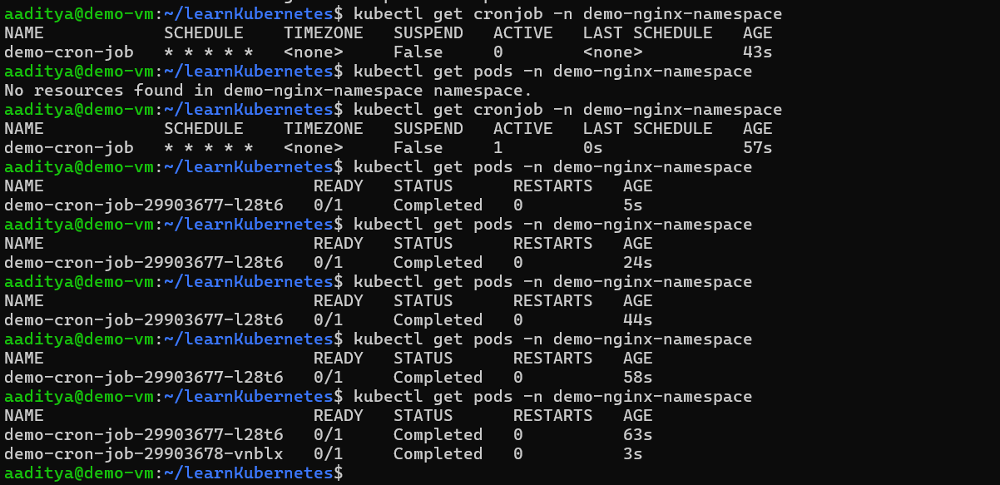

<h4> BASIC NOTES APP using Deployment and Service</h4>
<h4>YAML File to Create NameSpace for notes app</h4>

```
kind: Namespace
apiVersion: v1
metadata:
  name: notes-app-namespace
```
<h4>YAML File to Create Deployment for notes app</h4>

```
kind: Namespace
apiVersion: v1
metadata:
  name: notes-app-namespace

Notes App Deployment:
kind: Deployment
apiVersion: apps/v1
metadata:
  name: notes-app-deployment
  namespace: notes-app-namespace
  labels:
    app: notes-app
spec:
  replicas: 3
  selector:
    matchLabels:
      app: notes-app
  template:
    metadata:
      labels:
        app: notes-app
    spec:
      containers:
      - name: notes-app-container
        image: demoregistry123456.azurecr.io/notes-app:v1
        ports:
        - containerPort: 8000
      imagePullSecrets:
      - name: acr-secret
```

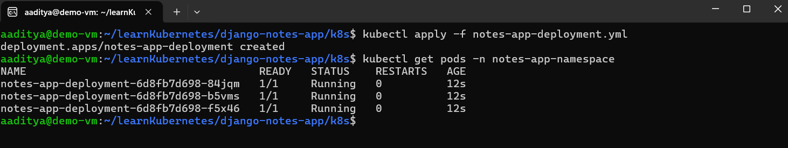

<h4>YAML File to Create Service for notes app</h4>

```
kind: Service
apiVersion: v1
metadata:
  name: notes-app-service
  namespace: notes-app-namespace
spec:
  selector:
    app: notes-app
  ports:
    - protocol: TCP
      port: 8000
      targetPort: 8000
  type: ClusterIP

```

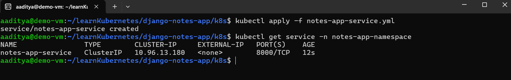
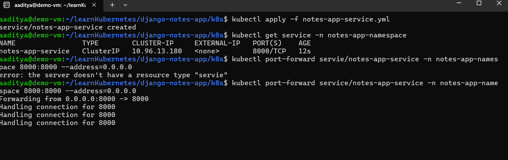
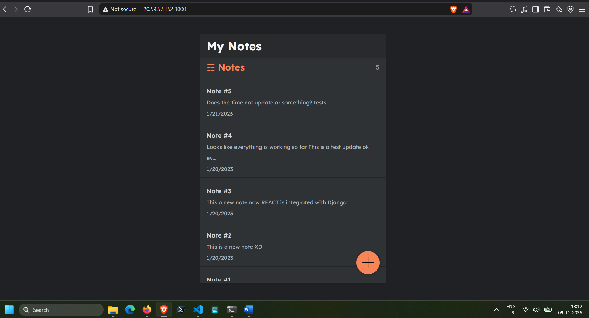

<h2>A BASIC NOTES APP PROJECT WHERE THE DOCKERFILE IS HOSTED AND FETCHED FROM AZURE CONTAINER REGISTRY AND 
  THE APP IS DEPLOYED USING INGRESS AND RUNNING ON A AZURE VM</h1>

<h3>URL For Notes APP: http://notes-app-demo.westus2.cloudapp.azure.com:8080 /</h3>
<h3>URL For Nginx App (Ingress path based Routing):  http://notes-app-demo.westus2.cloudapp.azure.com:8080/nginx-app /</h3>
  
<h4>Creating INGRESS Controller in KIND using YAML</h4>

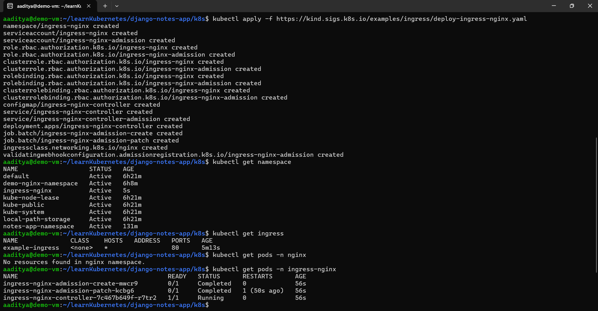

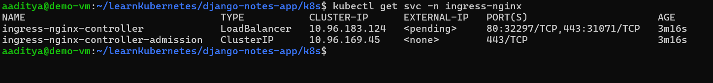
  
<h4>notes-app-namespace.yml</h4>

```
kind: Namespace
apiVersion: v1
metadata:
  name: notes-app-namespace
```

<h4>notes-app-deployment.yml</h4>

```
kind: Deployment
apiVersion: apps/v1
metadata:
  name: notes-app-deployment
  namespace: notes-app-namespace
  labels:
    app: notes-app
spec:
  replicas: 3
  selector:
    matchLabels:
      app: notes-app
  template:
    metadata:
      labels:
        app: notes-app
    spec:
      containers:
      - name: notes-app-container
        image: demoregistry123456.azurecr.io/notes-app:v1
        ports:
        - containerPort: 8000
      imagePullSecrets:
      - name: acr-secret
```

<h4>notes-app-service.yml</h4>

```
kind: Service
apiVersion: v1
metadata:
  name: notes-app-service
  namespace: notes-app-namespace
spec:
  selector:
    app: notes-app
  ports:
    - protocol: TCP
      port: 8000
      targetPort: 8000
  type: ClusterIP
```

<h4>demo-nginx-deployment.yml</h4>

```
kind: Deployment
apiVersion: apps/v1
metadata:
  name: nginx-deployment
  namespace: notes-app-namespace
  labels:
    app: nginx-app
spec:
  replicas: 3
  selector:
    matchLabels:
      app: nginx-app
  template:
    metadata:
      labels:
        app: nginx-app
    spec:
      containers:
      - name: nginx-app-container
        image: nginx
        ports:
        - containerPort: 8000
      
```

<h4>nginx-app-service.yml</h4>

```
kind: Service
apiVersion: v1
metadata:
  name: nginx-service
  namespace: notes-app-namespace
spec:
  selector:
    app: nginx-app
  ports:
    - protocol: TCP
      port: 80
      targetPort: 80
  type: ClusterIP
```

<h4>ingress.yml</h4>

```
apiVersion: networking.k8s.io/v1
kind: Ingress
metadata:
  name: nginx-notes-ingress
  namespace: notes-app-namespace
  annotations: 
    nginx.ingress.kubernetes.io/rewrite-target: /
spec:
  rules:
  - http:
      paths:
      - pathType: Prefix 
        path: /nginx
        backend: 
          service:
            name: nginx-service
            port:
              number: 80
      - pathType: Prefix 
        path: /
        backend: 
          service:
            name: notes-app-service
            port:
              number: 8000
```

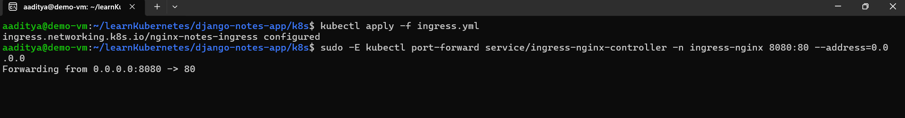
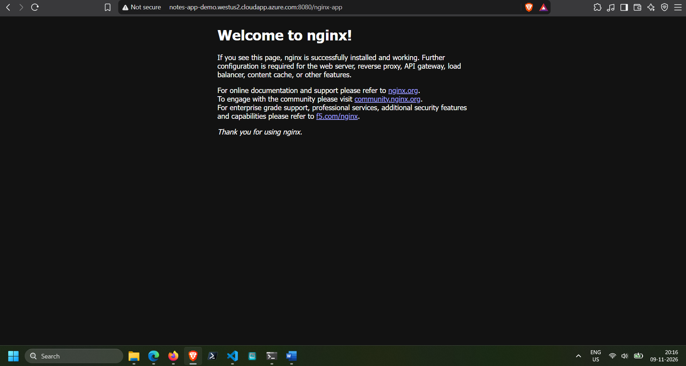
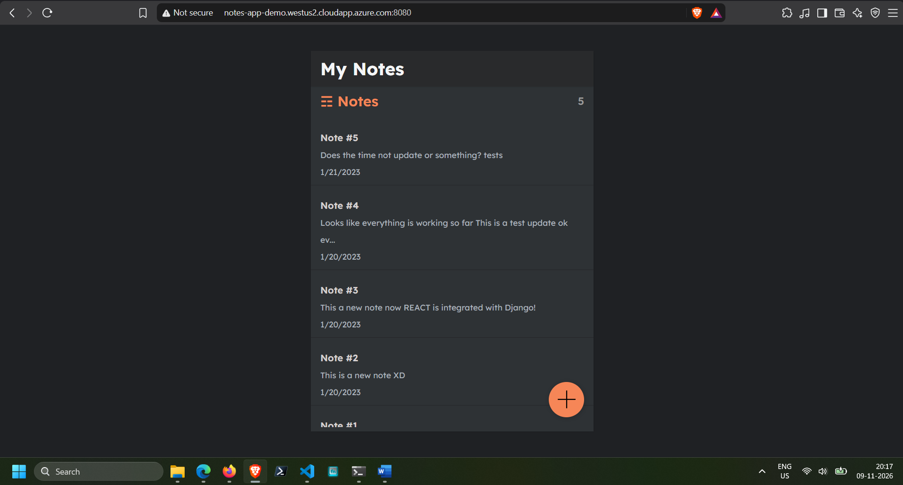
