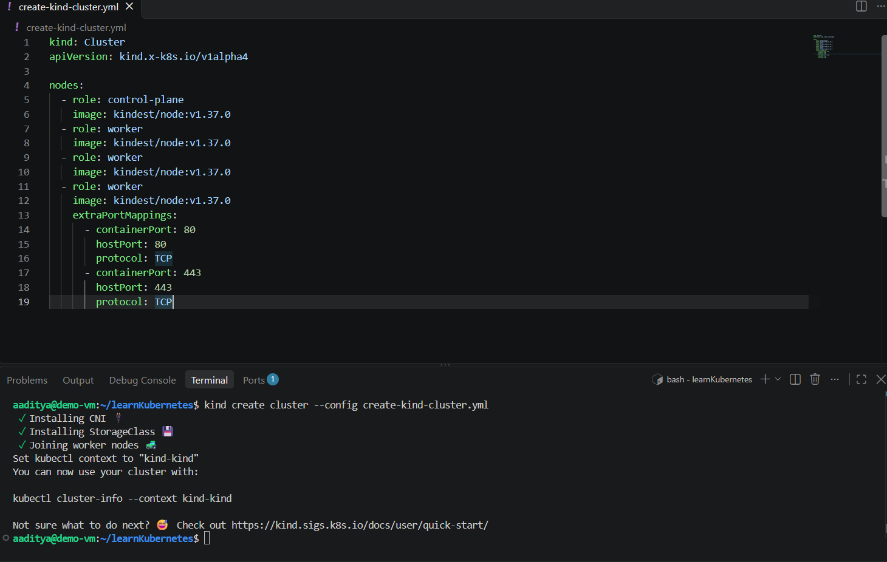
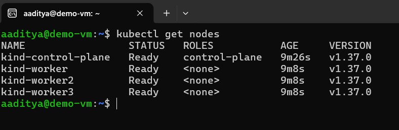
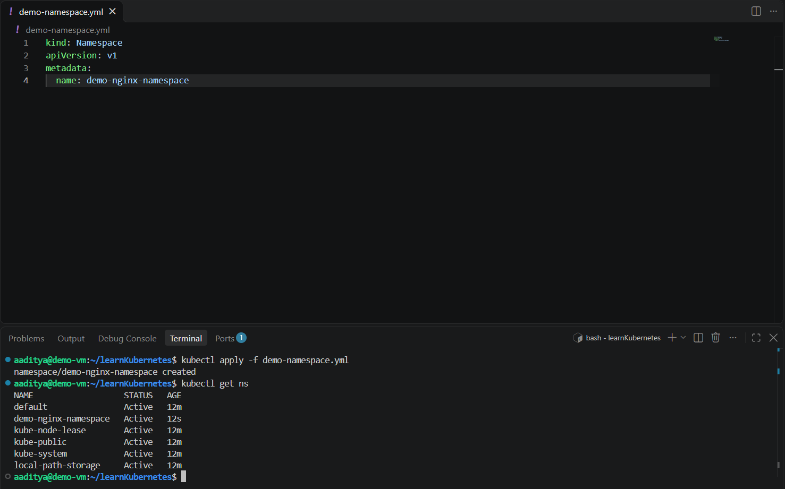

<h2>KUBERNETES PORTFOLIO</h2>
<h3>Provisioned a multi-node Kubernetes cluster locally using kind (Kubernetes in Docker)</h3>
<h4>YAML File to create KIND cluster:</h4>

```
kind: Cluster
apiVersion: kind.x-k8s.io/v1alpha4

nodes:
  - role: control-plane
    image: kindest/node:v1.37.0
  - role: worker
    image: kindest/node:v1.37.0
  - role: worker
    image: kindest/node:v1.37.0
  - role: worker
    image: kindest/node:v1.37.0
    extraPortMappings:
      - containerPort: 80
        hostPort: 80
        protocol: TCP
      - containerPort: 443
        hostPort: 443
        protocol: TCP
```  



<h4> YAML File to create NameSpace using YAML </h4>

```
kind: Namespace
apiVersion: v1
metadata:
  name: demo-nginx-namespace
```


